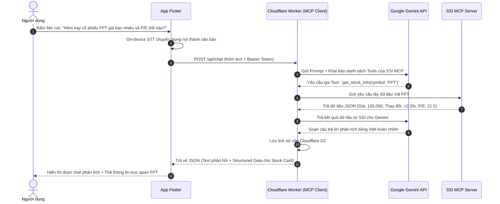

# TÀI LIỆU KIẾN TRÚC & THIẾT KẾ HỆ THỐNG
# ỨNG DỤNG TRỢ LÝ AI CHỨNG KHOÁN VIỆT NAM (AI STOCK ASSISTANT)

> **Mục tiêu:** Ứng dụng di động đa nền tảng (iOS & Android) tích hợp trợ lý AI chuyên biệt về thị trường chứng khoán Việt Nam. Kết hợp công nghệ ngôn ngữ tự nhiên từ Google Gemini và nguồn dữ liệu tài chính chính thống từ SSI MCP Server. Toàn bộ hạ tầng vận hành với chi phí 0 VNĐ.

---

## 1. TỔNG QUAN HỆ THỐNG

### 1.1. Định vị sản phẩm
* **Tên dự án (dự kiến):** StockAI / FinChat VN.
* **Loại ứng dụng:** Trợ lý AI tài chính & Tra cứu thị trường chứng khoán.
* **Hình thức tương tác:** Trò chuyện đa phương thức (Gõ chữ + Nhận diện giọng nói tiếng Việt qua Micro).
* **Nguồn dữ liệu:**
  * **Bộ não phân tích:** Google Gemini API (Gemini 2.0 / 1.5 Flash qua Google AI Studio).
  * **Dữ liệu tài chính & thị trường:** SSI MCP Server (`https://mcp.ssi.com.vn/mcp`).
  * **Hạ tầng Serverless & CSDL:** Cloudflare Workers + Cloudflare D1.
  * **Ứng dụng Mobile:** Flutter (Android & iOS).

### 1.2. Tính năng cốt lõi
1. **Hỏi đáp thông minh bằng giọng nói & văn bản:**
   * Bấm giữ mic để đặt câu hỏi bằng tiếng Việt tự nhiên (ví dụ: *"Hôm nay VN-Index tăng hay giảm?", "Phân tích biên lợi nhuận của HPG quý gần nhất"*).
2. **Dữ liệu chuẩn xác 100% từ SSI (Chống AI bịa đặt / Hallucination):**
   * AI tự động gọi các Tools của SSI MCP để trích xuất số liệu thực tế trước khi phân tích.
   * Tra cứu giá thời gian thực (Real-time), chỉ số VN-Index, VN30, HNX.
   * Tra cứu chỉ số định giá tài chính: P/E, P/B, ROE, ROA, EPS, nợ/vốn.
   * Tra cứu báo cáo tài chính, tin tức doanh nghiệp, dòng tiền, khối ngoại mua/bán ròng.
3. **Thẻ trực quan (Rich UI Stock Cards):**
   * Khi nhắc đến một mã cổ phiếu (ví dụ: `FPT`), ứng dụng tự động hiển thị thẻ tóm tắt: Giá hiện tại (xanh/đỏ/tím), % tăng giảm, biểu đồ mini (Sparkline) và các chỉ số tài chính cơ bản.
4. **Danh mục theo dõi (Watchlist):**
   * Lưu các mã cổ phiếu quan tâm để mở app là thấy ngay biến động.

---

## 2. KIẾN TRÚC HỆ THỐNG (SYSTEM ARCHITECTURE)

### 2.1. Sơ đồ khối tổng thể

```mermaid
flowchart TD
    User(["Người dùng (Nói / Gõ tiếng Việt)"])

    subgraph Client ["Ứng dụng Di động (Flutter - iOS & Android)"]
        UI["Giao diện Chat & Watchlist"]
        STT["iOS/Android Speech-to-Text (On-device)"]
        StockCard["Rich UI Stock Card & Sparkline Chart"]
        LocalStorage["Local Cache (hive / shared_preferences)"]
    end

    subgraph Backend ["Hạ tầng Cloudflare (Serverless - Miễn phí)"]
        Worker["Cloudflare Worker (MCP Client & API Gateway)"]
        AuthMiddleware["Xác thực Secret Token"]
        D1[("Cloudflare D1 Database\n(Watchlist & Lịch sử Chat)")]
    end

    subgraph External_AI_Data ["Dịch vụ AI & Dữ liệu Chứng khoán"]
        Gemini["Google Gemini 2.0 Flash\n(Google AI Studio - Free Tier)"]
        SSIMCP["SSI MCP Server\n(https://mcp.ssi.com.vn/mcp)\n- Giá real-time, VN-Index\n- BCTC, P/E, P/B, ROE\n- Tin tức, dòng tiền"]
    end

    User <-->|Tương tác| UI
    UI <--> STT
    UI <--> StockCard
    UI <--> LocalStorage

    UI <-->|HTTPS + Bearer Token| AuthMiddleware
    AuthMiddleware <--> Worker
    Worker <--> D1
    Worker <-->|Function Calling| Gemini
    Worker <-->|Giao thức MCP (SSE/JSON-RPC)| SSIMCP
```

---

### 2.2. Luồng xử lý một câu hỏi (Sequence Diagram)



---

## 3. THIẾT KẾ CƠ SỞ DỮ LIỆU (CLOUDFLARE D1)

Cloudflare D1 là cơ sở dữ liệu quan hệ dựa trên SQLite, vận hành serverless.

```sql
-- 1. Bảng danh mục cổ phiếu theo dõi (Watchlist)
CREATE TABLE IF NOT EXISTS watchlist (
    id INTEGER PRIMARY KEY AUTOINCREMENT,
    symbol TEXT NOT NULL UNIQUE,          -- Mã cổ phiếu (VD: FPT, HPG)
    market TEXT DEFAULT 'HOSE',           -- Sàn: HOSE, HNX, UPCOM
    target_price REAL,                    -- Giá mục tiêu kỳ vọng (nếu có)
    note TEXT,                            -- Ghi chú cá nhân
    created_at DATETIME DEFAULT CURRENT_TIMESTAMP
);

-- 2. Bảng hội thoại (Conversations)
CREATE TABLE IF NOT EXISTS conversations (
    id TEXT PRIMARY KEY,                  -- UUID của phiên chat
    title TEXT NOT NULL,                  -- Tiêu đề tóm tắt (VD: "Hỏi về FPT & HPG")
    created_at DATETIME DEFAULT CURRENT_TIMESTAMP,
    updated_at DATETIME DEFAULT CURRENT_TIMESTAMP
);

-- 3. Bảng tin nhắn (Chat Messages)
CREATE TABLE IF NOT EXISTS chat_messages (
    id INTEGER PRIMARY KEY AUTOINCREMENT,
    conversation_id TEXT NOT NULL,
    sender TEXT NOT NULL CHECK(sender IN ('user', 'assistant')),
    content TEXT NOT NULL,                -- Nội dung phản hồi bằng chữ
    structured_data TEXT,                 -- Dữ liệu JSON chứa mã, giá, P/E (để render Card)
    created_at DATETIME DEFAULT CURRENT_TIMESTAMP,
    FOREIGN KEY (conversation_id) REFERENCES conversations(id) ON DELETE CASCADE
);

-- 4. Bảng cấu hình & Token SSI
CREATE TABLE IF NOT EXISTS app_settings (
    key TEXT PRIMARY KEY,
    value TEXT NOT NULL,
    updated_at DATETIME DEFAULT CURRENT_TIMESTAMP
);
```

---

## 4. TÍCH HỢP SSI MCP & GOOGLE GEMINI

### 4.1. Thông số kết nối SSI MCP
* **Endpoint:** `https://mcp.ssi.com.vn/mcp`
* **Giao thức:** Model Context Protocol (JSON-RPC 2.0 qua SSE/HTTP POST).
* **Xác thực:** Đăng nhập phiên tài khoản SSI thông qua cổng `accounts.ssi.com.vn`. Session token được lưu trong Cloudflare D1 hoặc KV.
* **Phạm vi khả dụng:**
  * Bảng giá trực tuyến, chỉ số VN-Index, VN30, HNX-Index.
  * Chỉ số tài chính: P/E, P/B, ROE, ROA, EPS, cổ tức.
  * Dữ liệu giao dịch khớp lệnh, nước ngoài mua/bán ròng.
  * Báo cáo tài chính vĩ mô và tin tức doanh nghiệp.

### 4.2. Cấu hình Gemini API (Google AI Studio)
* **Model khuyến nghị:** `gemini-2.0-flash` hoặc `gemini-1.5-flash`.
* **Ưu điểm:** Hỗ trợ Function Calling vượt trội, độ trễ cực thấp (< 1s), am hiểu tiếng Việt tài chính sâu sắc.
* **Chi phí:** Miễn phí 15 requests/phút, 1.500 requests/ngày (Google AI Studio Free Tier).

---

## 5. CẤU TRÚC DỰ ÁN (PROJECT DIRECTORY TREE)

```
project-root/
│
├── worker/                                # Backend Cloudflare Worker (TypeScript)
│   ├── src/
│   │   ├── index.ts                       # Entry point, router, xác thực Token
│   │   ├── services/
│   │   │   ├── gemini.ts                  # Gọi Google Gemini API (Function calling)
│   │   │   ├── ssi_mcp_client.ts          # Kết nối SSI MCP Server (Client MCP)
│   │   │   └── database.ts                # Tương tác Cloudflare D1
│   │   └── types/
│   │       └── index.ts                   # Định nghĩa Interface & Types
│   ├── schema.sql                         # File khởi tạo database D1
│   ├── wrangler.toml                      # Cấu hình Cloudflare Worker & D1 binding
│   └── package.json
│
├── mobile/                                # Frontend Flutter App (iOS & Android)
│   ├── lib/
│   │   ├── main.dart                      # Khởi chạy app, cấu hình theme
│   │   ├── core/
│   │   │   ├── constants/api_constants.dart
│   │   │   └── network/api_client.dart    # Dio client kết nối Cloudflare Worker
│   │   ├── models/
│   │   │   ├── message_model.dart
│   │   │   └── stock_data_model.dart
│   │   ├── providers/                     # State management (Riverpod)
│   │   │   ├── chat_provider.dart
│   │   │   └── watchlist_provider.dart
│   │   └── screens/
│   │       ├── chat_screen.dart           # Màn hình chat chính (Văn bản & Giọng nói)
│   │       ├── watchlist_screen.dart      # Màn hình danh mục theo dõi
│   │       └── widgets/
│   │           ├── voice_record_button.dart # Nút bấm ghi âm mic
│   │           ├── stock_summary_card.dart  # Thẻ hiển thị giá & chỉ số tài chính
│   │           └── sparkline_chart.dart     # Biểu đồ mini
│   ├── pubspec.yaml
│   └── .github/workflows/build_ios.yml    # CI/CD tự động build IPA miễn phí
│
└── app_finance_chat.md                    # Tài liệu kiến trúc dự án này
```

---

## 6. HƯỚNG DẪN CÀI ĐẶT & TRIỂN KHAI TỪNG BƯỚC

### Bước 1: Chuẩn bị tài nguyên miễn phí
1. **Google AI Studio:** Truy cập [aistudio.google.com](https://aistudio.google.com/) $\rightarrow$ Bấm **Get API key** $\rightarrow$ Lưu lại `GEMINI_API_KEY`.
2. **Cloudflare Account:** Tạo tài khoản miễn phí tại [cloudflare.com](https://cloudflare.com).
3. **Tài khoản SSI:** Đảm bảo có tài khoản chứng khoán SSI đang hoạt động để xác thực với `mcp.ssi.com.vn`.

### Bước 2: Thiết lập Backend Cloudflare Worker & D1
```bash
# 1. Cài đặt Wrangler CLI
npm install -g wrangler

# 2. Đăng nhập vào Cloudflare
npx wrangler login

# 3. Tạo cơ sở dữ liệu D1
npx wrangler d1 create stockai-db

# 4. Khởi tạo các bảng từ file schema.sql
npx wrangler d1 execute stockai-db --file=./worker/schema.sql

# 5. Lưu trữ Secret Key bảo mật
npx wrangler secret put GEMINI_API_KEY
npx wrangler secret put APP_CLIENT_SECRET
```

### Bước 3: Phát triển ứng dụng Flutter
1. Tạo dự án: `flutter create --org com.stockai stockai_app`.
2. Thêm các thư viện thiết yếu vào `pubspec.yaml`:
   ```yaml
   dependencies:
     flutter:
       sdk: flutter
     flutter_riverpod: ^2.5.1
     dio: ^5.4.3
     speech_to_text: ^6.6.1
     permission_handler: ^11.3.1
     fl_chart: ^0.68.0
     shared_preferences: ^2.2.3
   ```
3. Cấp quyền Micro trong file:
   * **iOS:** `ios/Runner/Info.plist` (Thêm `NSSpeechRecognitionUsageDescription` và `NSMicrophoneUsageDescription`).
   * **Android:** `android/app/src/main/AndroidManifest.xml` (Thêm quyền `RECORD_AUDIO`).

### Bước 4: Đóng gói và cài đặt lên điện thoại
* **Android:** 
  * Chạy lệnh: `flutter build apk --release`.
  * Copy file `.apk` vào điện thoại cài đặt trực tiếp, sử dụng vĩnh viễn.
* **iOS (Không cần máy Mac):**
  * Đẩy code Flutter lên GitHub cá nhân.
  * Sử dụng **GitHub Actions** với runner `macos-latest` để tự động build file `.ipa`.
  * Tải file `.ipa` từ GitHub Actions về máy tính Windows $\rightarrow$ Dùng **Sideloadly** nạp vào iPhone cá nhân.

---

## 7. BẢNG DỰ TOÁN CHI PHÍ VẬN HÀNH

| Thành phần | Dịch vụ sử dụng | Hạn mức miễn phí | Chi phí hàng tháng |
| :--- | :--- | :--- | :---: |
| **Backend Compute** | Cloudflare Workers | 100.000 requests/ngày | **0 VNĐ** |
| **Cơ sở dữ liệu** | Cloudflare D1 | 5 triệu lượt đọc, 100.000 lượt ghi/ngày | **0 VNĐ** |
| **Trí tuệ nhân tạo** | Google Gemini 2.0 Flash | 15 req/phút, 1.500 req/ngày | **0 VNĐ** |
| **Dữ liệu chứng khoán** | SSI MCP Server | Miễn phí cho người dùng SSI | **0 VNĐ** |
| **CI/CD Build iOS** | GitHub Actions | 2.000 phút build/tháng | **0 VNĐ** |
| **TỔNG CỘNG** | | | **0 VNĐ** |

---

## 8. CÁC KỊCH BẢN HỎI ĐÁP MẪU TRÊN ỨNG DỤNG

1. **Tra cứu thị trường tổng quan:**
   * *"Hôm nay VN-Index đóng cửa bao nhiêu điểm, khối ngoại mua hay bán ròng?"*
   * $\rightarrow$ AI gọi SSI MCP lấy dữ liệu thị trường trong phiên $\rightarrow$ Tóm tắt ngắn gọn kèm chỉ số chính.
2. **Định giá & Phân tích cơ bản:**
   * *"So sánh chỉ số P/E và ROE của FPT và MWG xem mã nào đang định giá hấp dẫn hơn?"*
   * $\rightarrow$ AI lấy P/E, ROE của cả 2 mã từ SSI $\rightarrow$ Lập bảng so sánh ngắn gọn.
3. **Phân tích kết quả kinh doanh:**
   * *"Tình hình kinh doanh quý vừa rồi của HPG thế nào, biên lợi nhuận có cải thiện không?"*
   * $\rightarrow$ AI đọc báo cáo tài chính HPG từ SSI $\rightarrow$ Diễn giải dễ hiểu cho nhà đầu tư cá nhân.

